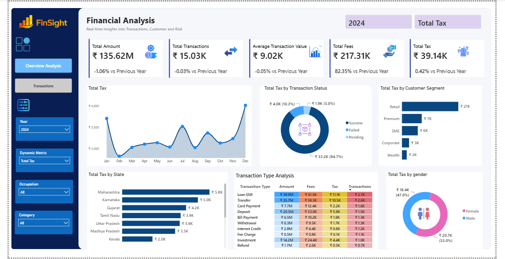
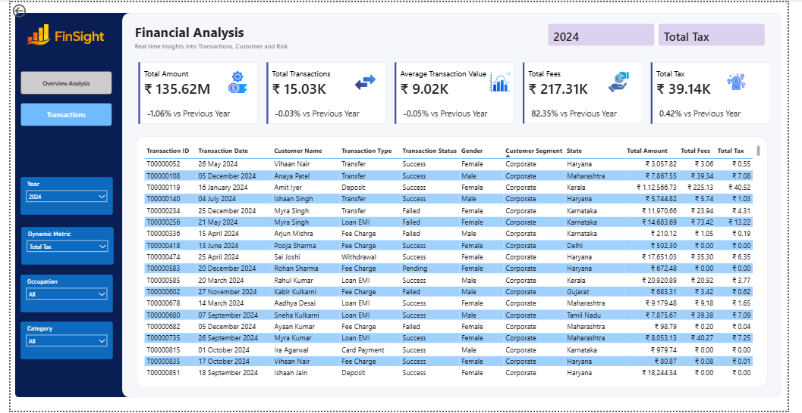

<div align="center">

# Finance Analytics & Transaction Risk Monitoring

### From raw financial transactions to actionable operational intelligence


**Business requirements → SQL validation → Python analysis → Power BI reporting → Recommendations**

[View Dashboard](#dashboard-preview) · [Explore Findings](#key-analytical-findings) · [Read Business Report](Docs/Business_Insights_Recommendations_Report.pdf) · [Reproduce Analysis](#how-to-reproduce)

</div>

> **Data transparency:** This is a portfolio case study based on synthetic educational data. Recommendations are proposed, not implemented business outcomes. Existing fraud flags are not independently confirmed fraud cases.

## Executive snapshot

| **50,000** | **85.74%** | **10.19%** | **5,000** |
|:---:|:---:|:---:|:---:|
| Clean transactions | Success rate | Failure rate | Customers |

**Decision focus:** Transaction reliability · Risk-review prioritization · Customer activity · KPI integrity

## Business problem

A digital financial-services provider needs reliable answers to four operational questions:

1. **Transaction reliability:** How many transactions fail, and is there evidence of unusually poor performance by channel, transaction type, or month?
2. **Risk operations:** How does a risk-score cutoff change the size of the review queue and its coverage of existing fraud flags?
3. **Customer engagement:** Which customers have little or no recorded activity, and where is transaction volume concentrated?
4. **Reporting accuracy:** Can analysts remove duplicates, standardize values, and reconcile transaction and customer counts before reporting KPIs?

## Project at a glance

| Measure | Verified result |
|---|---:|
| Raw transaction rows | 50,069 |
| Deduplicated / cleaned transactions | 50,000 |
| Customer records | 5,000 |
| Removed duplicate transaction rows | 69 |
| Successful transactions | 42,869 (85.74%) |
| Failed transactions | 5,096 (10.19%) |
| Pending transactions | 2,035 (4.07%) |
| Duplicate IDs in cleaned transactions | 0 |
| Transactions without a matching customer | 0 |

The raw dataset contains a conflicting duplicate for transaction `T00000009`; the deduplication view prioritizes its nonblank fee value. The SQL validation checks confirm the cleaned transaction and customer ID counts.

## Dashboard preview

> Two report pages are included below. The `.pbix` file is available for interactive exploration in Power BI Desktop.

### Overview Analysis



### Transactions



**[Open the Power BI report](Power%20BI/Finance_Analytics_Dashboard.pbix)**

## Approach and tools

| Stage | Technology | Work performed |
|---|---|---|
| Requirements | BRD | Defined business questions, KPIs, scope, and acceptance criteria |
| Data ingestion | SQL Server / T-SQL | Created raw staging tables and loaded source CSVs |
| Data validation | T-SQL | Profiled duplicates, missing values, and inconsistent fields; created validated views |
| Business analysis | T-SQL | Calculated operational KPIs and reconciled report measures |
| Statistical analysis | Python / pandas / SciPy / statsmodels | Tested failure patterns, examined customer activity, and compared risk thresholds |
| Reporting | Power BI | Built an Overview Analysis page and a Transactions page |
| Decision support | Business insights report | Documented findings, limitations, and recommended next steps |

### SQL data pipeline

```text
Data/customers.csv                 Data/finance_transactions.csv
         |                                      |
         v                                      v
raw.customers                      raw.finance_transactions
         |                                      |
         v                                      v
validated.clean_customers          validated.finance_transactions
                                                |
                                                v
                                    validated.clean_transactions
                       \                        /
                        \                      /
                         v                    v
                        SQL KPI checks + Python analysis
                                      |
                                      v
                           Power BI + business report
```

The transaction deduplication view retains one row per `transaction_id`, preferring a record with a populated fee when duplicate IDs conflict. The cleaned views standardize fields and convert dates and numeric values using `TRY_CONVERT`. Negative amounts and missing fees are **flagged for review**, not automatically discarded.

## Key analytical findings

The findings below describe **observed patterns in the supplied data**, not causal effects or achieved improvements.

### 1. Transaction reliability

- **5,096 of 50,000** transactions failed, a **10.19%** observed failure rate.
- A channel-versus-success association test produced **p ≈ 0.098** and **Cramér's V ≈ 0.015**: insufficient evidence of a meaningful overall channel association at a 5% significance level.
- The notebook's multiple-testing-adjusted screening did **not** identify statistically significant elevated channel/type failure combinations or monthly failure anomalies.

**Business implication:** Monitor failure trends and investigate operational causes, but avoid claiming a specific channel is systematically worse based on these results alone.

### 2. Risk-review workload

| Risk-score cutoff | Transactions queued | Share of 50,000 attempts | Existing fraud flags covered |
|---|---:|---:|---:|
| ≥ 65 | 4,884 | 9.77% | 100% |
| ≥ 70 | 1,212 | 2.42% | 84.92% |
| ≥ 75 | 460 | 0.92% | 73.02% |

**Business implication:** Higher thresholds reduce the number of cases requiring review, but also reduce coverage of existing flags. The flag may be related to the risk score itself; these are **queue-sizing comparisons, not independently validated detection rates**. Real deployment would require confirmed outcomes, false-positive costs, and investigator-capacity constraints.

### 3. Customer activity

| Activity segment | Customers | Share of customers | Share of transaction attempts |
|---|---:|---:|---:|
| No recorded activity | 1,017 | 20.34% | 0% |
| Low | 1,224 | 24.48% | 12.46% |
| Medium | 1,863 | 37.26% | 44.63% |
| High | 896 | 17.92% | 42.91% |

**Business implication:** Examine onboarding and activation opportunities for customers with no recorded transactions, while monitoring the concentration of transaction activity. No recorded activity does not necessarily mean churn.

### 4. Data quality and KPI confidence

- Reconciled **50,069 raw rows** to **50,000 unique transaction IDs**.
- Verified **5,000 distinct customer IDs**, **zero duplicate cleaned transaction IDs**, and **zero unmatched customer references**.
- Retained quality indicators for missing fees and negative amounts rather than silently treating every unusual value as invalid.

**Business implication:** Reduce double counting and make reporting assumptions auditable before management decisions are based on KPI dashboards.

## Business problem → analysis → action

| Operational challenge | Evidence from this project | Proposed business response |
|---|---|---|
| Transaction failures | 5,096 failures (10.19%) | Monitor failure trends and investigate root causes with operational error data |
| Risk-review capacity | 460–4,884 transactions queued depending on threshold | Pilot score-based prioritization with independently confirmed outcomes |
| Customer engagement | 1,017 customers have no recorded activity | Test onboarding and activation interventions |
| Reporting accuracy | 69 duplicate transaction rows removed | Automate data-quality checks before KPI reporting |

**Potential value:** Better operational visibility, more focused investigations, and more trustworthy reporting. No financial savings or deployed improvement is claimed.

## Recommended business actions

| Priority | Proposed action | How success could be measured |
|---|---|---|
| 1 | Establish recurring transaction-success and data-quality monitoring | Failure-rate trend, duplicate count, missing-field rate |
| 2 | Investigate failure causes using richer operational event and error-code data | Root-cause resolution, independently observed change in failure rate |
| 3 | Pilot risk-score review queues with investigator feedback | Confirmed detection outcomes, false-positive rate, queue size, review time |
| 4 | Test customer onboarding / reactivation interventions | Experiment-based activation and repeat-use rates |

These actions are **recommendations**, not documented improvements achieved by this project.

## Repository structure

```text
Finance-Analytics-Transaction-Risk-Monitoring/
├── Assets/
│   ├── dashboard_overview.png
│   └── dashboard_transactions.png
├── Data/
│   ├── customers.csv
│   └── finance_transactions.csv
├── Docs/
│   ├── Business_Requirements_Document.pdf
│   └── Business_Insights_Recommendations_Report.pdf
├── Power BI/
│   └── Finance_Analytics_Dashboard.pbix
├── Python/
│   └── Finance_Analytics_Python_Analysis.ipynb
├── SQL/
│   ├── 00_database_setup.sql
│   ├── 01_create_customers_table.sql
│   ├── 02_create_transactions_table.sql
│   ├── 03_import_data.sql
│   ├── 04_data_duplicate_check.sql
│   ├── 05_missing_data_check.sql
│   ├── 06_clean_customers.sql
│   ├── 07_business_analysis.sql
│   ├── 08_kpi_reconciliation.sql
│   └── 09_data_quality_validation.sql
├── requirements.txt
├── .gitignore
└── README.md
```

**[Read the Business Requirements Document](Docs/Business_Requirements_Document.pdf)** · **[Read the Business Insights & Recommendations Report](Docs/Business_Insights_Recommendations_Report.pdf)** · **[Explore the Python notebook](Python/Finance_Analytics_Python_Analysis.ipynb)**

## How to reproduce

**Prerequisites:** Microsoft SQL Server, SSMS or a compatible T-SQL client, Python 3, the Microsoft ODBC Driver 17 or 18 for SQL Server, and Power BI Desktop to open the `.pbix` file. The notebook uses Windows Authentication to connect to the local SQL Server instance.

1. **Clone or download** this repository.
2. **Create the database and tables** by running `SQL/00_database_setup.sql`, `01_create_customers_table.sql`, and `02_create_transactions_table.sql` in that order.
3. **Import the CSVs:** edit the two absolute file paths in `SQL/03_import_data.sql` to locations accessible by the SQL Server service, then execute the import **once into empty raw tables**. Expected counts: **5,000 customers** and **50,069 raw transaction rows**.
4. **Create validated views:** run `SQL/04_data_duplicate_check.sql`, `05_missing_data_check.sql`, and `06_clean_customers.sql` in that order. These scripts also contain diagnostic queries. The clean-transactions view depends on the deduplicated-transactions view.
5. **Run the checks and business analysis:** execute `SQL/07_business_analysis.sql`, `08_kpi_reconciliation.sql`, and `09_data_quality_validation.sql`.
6. **Install Python dependencies** from the repository root:

   ```bash
   python -m pip install -r requirements.txt
   ```

7. **Configure the notebook:** open `Python/Finance_Analytics_Python_Analysis.ipynb`, check the `server = "localhost"` and `database = "FinanceAnalyticsDB"` settings, and run cells in order. It queries the validated SQL Server views; it is **not** a standalone CSV-only notebook.
8. **Open the Power BI report** in Power BI Desktop. Depending on your computer, you may need to update its data-source connection and refresh settings.

**Reproducibility note:** The source database and SQL outputs were checked in the author's environment, but the entire project has **not yet been independently rebuilt and tested on a fresh machine**. Package versions are not pinned. The SQL import requires suitable filesystem permissions, and Windows-specific authentication may need adaptation elsewhere.

## Limitations

- **Synthetic educational dataset:** conclusions illustrate an analytical workflow, not a production bank's operating performance.
- **Fraud-label independence:** the existing `is_fraud` flags may be derived from risk scores, so flag coverage is not equivalent to verified fraud detection.
- **Observational analysis:** failure patterns and customer activity do not establish causes or intervention effectiveness.
- **Local dependencies:** SQL Server, ODBC configuration, Power BI connectivity, and local CSV paths must be configured by each user.
- **No measured deployment impact:** financial savings, lower fraud losses, and improved conversion would require real implementation and evaluation.

## Project documents

- [Business Requirements Document](Docs/Business_Requirements_Document.pdf)
- [Business Insights & Recommendations Report](Docs/Business_Insights_Recommendations_Report.pdf)

## Connect with me

Interested in discussing the analysis, methodology, or Data Analyst opportunities? You can reach me through the channels below.

<!-- Replace the placeholders with your actual public profile URLs before publishing. -->
**LinkedIn:** www.linkedin.com/in/raghvendra-poojary
**GitHub:** https://github.com/raghvendra-poojary  
**Email (optional):** raghu.poojary1102@gmail.com

---

<div align="center">

*An end-to-end Data Analyst portfolio case study — built for transparent, reproducible, business-focused analysis.*

</div>
